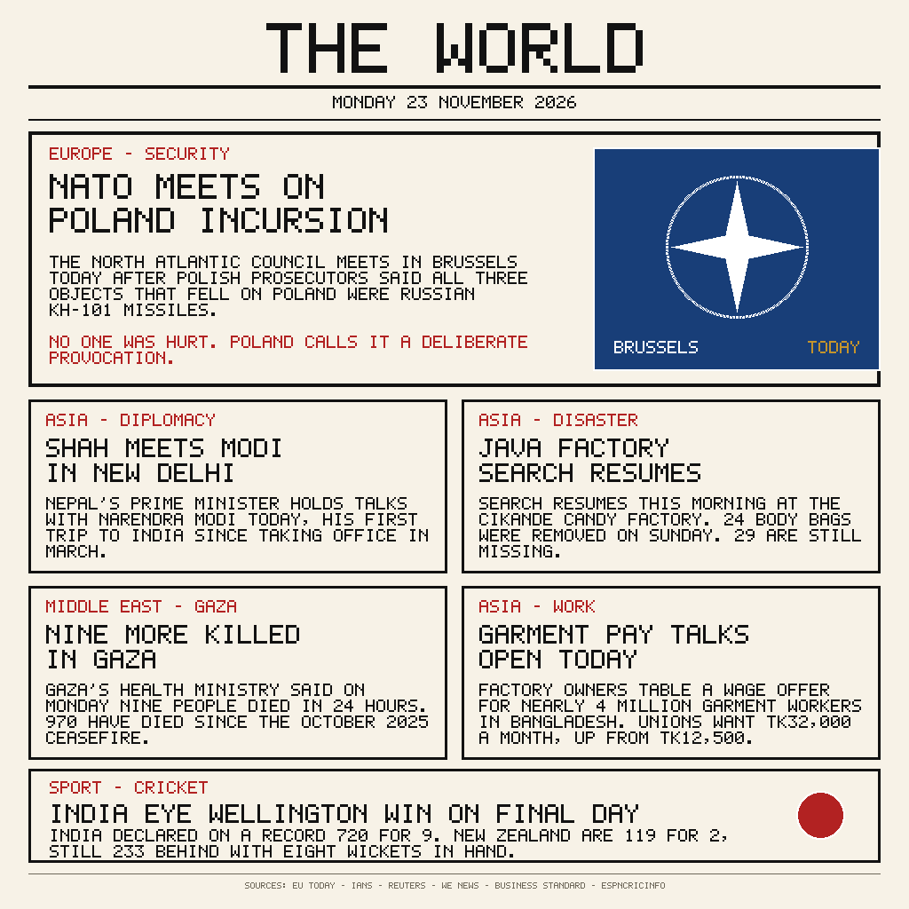

# THE WORLD — Monday 23 November 2026

[](https://make.fun/bounty/news-image-20261123?utm_source=github&utm_medium=readme&utm_campaign=news-image-20261123)
[](https://make.fun/bounty/news-image-20261123/leaderboard?utm_source=github&utm_medium=readme&utm_campaign=news-image-20261123)
[](https://make.fun/bounty/news-image-20261123?utm_source=github&utm_medium=readme&utm_campaign=news-image-20261123)

A newspaper front page that sums up the world's news of Monday 23 November 2026 in one image: NATO meets in Brussels over the Russian missiles that fell on Poland, Nepal's prime minister holds talks with Narendra Modi in New Delhi, the search resumes at the Java candy factory, nine more people are killed in Gaza, Bangladesh garment pay talks open, and India chase a Wellington Test win on the final day.



## Run

```sh
mkdir -p out && MAKEFUN_OUTPUT_DIR=out node main.ts
```

This writes `out/entry.png` (1024x1024, deterministic: two runs produce byte-identical output).

## How it works

`main.ts` (Node stdlib only, no network, no file reads at runtime) draws the whole page from code: a hand-written 5x7 bitmap font, a hand-written PNG encoder (CRC32, zlib deflate, IHDR/IDAT/IEND chunks), and simple vector shapes for the NATO compass star and the cricket ball. Nothing is copied in; the image is generated fresh on every run.

## Stories

See [AGENT.md](AGENT.md) for the six stories and the source behind each one. Every story was fact-checked against reporting dated 23 November 2026 (or a development dated that day, with the earlier incident named as such in the text). Stories from 21-22 November with no new 23 November development (COP31, the Peru quake, the Bahrain strikes, the Mexico cartel capture, the Korea minister's resignation) were deliberately left out.

## License

MIT — see [LICENSE](LICENSE).
